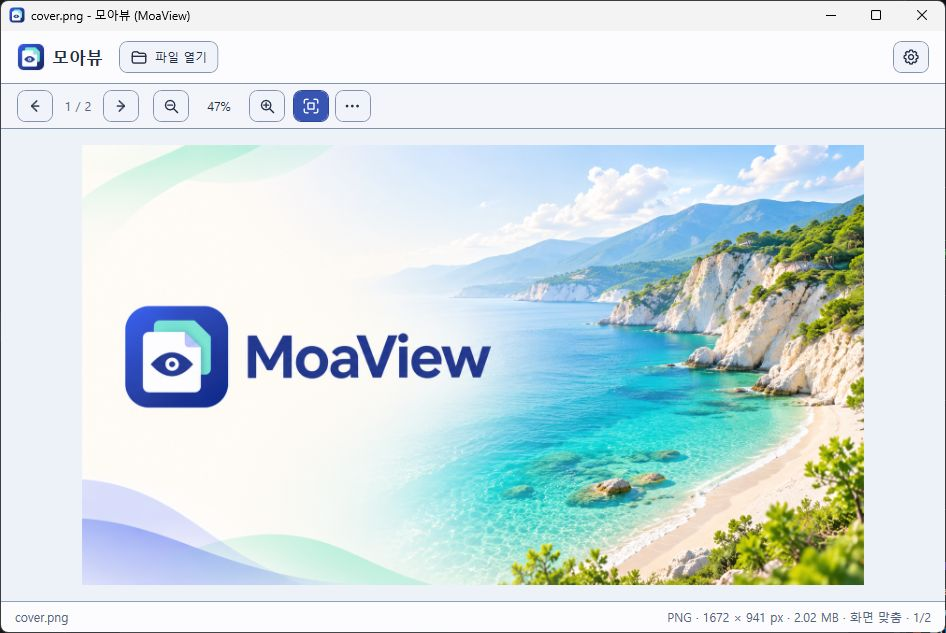

# 모아뷰 (MoaView)

모아뷰(MoaView)는 외부 미리보기 앱의 소스를 복제하거나 포크하지 않고 `.NET 8` / `WPF` 기반으로 자체 구현하는 독립 Windows 파일 미리보기 애플리케이션입니다.



라이트 테마에서 커버 이미지를 연 실제 MoaView 0.1.7 화면입니다.

WorkMesh 프로젝트 채널: `moaview`

## Windows 설치 파일

[최신 Windows x64 설치 파일 다운로드](https://github.com/hebory/moaview/releases/latest)

0.1.10 설치 파일의 출력 경로와 이름은 `artifacts/installer/MoaView-0.1.10-Setup-x64.exe`입니다. 빌드 명령은 `powershell -ExecutionPolicy Bypass -File scripts/Build-Installer.ps1 -Version 0.1.10`입니다. 설치 파일은 코드 서명이 없는 개발 배포본입니다. [설치 및 다시 빌드 안내](docs/install.md)

## 런처용 이미지

런처의 아이콘과 커버 경로에 아래 파일을 지정할 수 있습니다.

| 용도 | 파일 | 규격 |
| --- | --- | --- |
| 런처 아이콘 | [icon.png](icon.png) | 512 × 512 · 투명 PNG |
| 런처 커버 | [cover.png](cover.png) | 1672 × 941 · 가로형 PNG |
| Windows 아이콘 | [MoaView.ico](src/MoaView/Assets/Brand/MoaView.ico) | 16~256 px · 다중 해상도 ICO |

## 미리보기와 탐색기 연동

- 독립 솔루션(`MoaView.sln`), Windows WPF 실행 앱(`src/MoaView`), xUnit 기능 테스트(`tests/MoaView.Tests`) 구성
- 필요한 NuGet 패키지가 캐시에 있으면 오프라인 복원 가능하며, 단일 노드/노드 비재사용 빌드 설정으로 제한된 환경의 빌드를 지원합니다.
- 시작 화면의 **파일 열기**(`Ctrl+O`) 버튼이나 파일 끌어놓기로 미리봅니다. 실행 인수로 파일 경로도 전달할 수 있습니다.
- **설정**에서 앱 테마, 탐색기 연동, 마크다운 읽기 테마, 지원 형식과 단축키 안내를 확인합니다. 앱 테마는 **다크·라이트·세피아·오션·포레스트** 5가지이며 현재 사용자 설정으로 저장됩니다. 마크다운 읽기 테마는 앱 테마와 별도로 선택·저장합니다.
- 이미지가 열리면 확대·축소, 폴더 이전·다음, 화면 맞춤, 이미지 도구 아이콘이 표시됩니다. 아이콘 버튼은 키보드로 이동·실행할 수 있고, 포인터를 올리면 동작과 단축키가 보이며 보조 기술에는 접근 가능한 이름을 제공합니다. 이미지 도구에서 원본 크기·회전·변환 저장을 사용할 수 있습니다.
- 탐색기 Space 미리보기(C2): 모아뷰가 실행 중이면 탐색기 파일 목록에서 항목 하나를 선택하고 `Space`로 별도 미리보기 창을 열고 닫습니다. 탐색기 포커스를 유지하며, 같은 창에서 선택한 항목이 바뀌면 미리보기를 갱신합니다.
  - 기본 창을 닫아도 **트레이에서 계속 실행**되어 Space 미리보기를 사용할 수 있습니다. 트레이 아이콘 더블클릭으로 창을 다시 열고, 우클릭 메뉴에서 Space 연동 전환·완전 종료를 선택합니다.
  - **설정 → 탐색기 → Windows와 함께 시작**을 켜면 다음 로그인부터 창 없이 트레이에서 시작합니다. 설치할 때도 선택할 수 있으며 기본은 꺼짐입니다. `MoaView.exe --background`로 직접 백그라운드 실행할 수도 있습니다.
  - 주소창·검색창·이름 변경·메뉴·수정키 조합의 Space는 가로채지 않습니다. 여러 항목 선택, 선택 없음, 가상 Shell 항목은 열지 않습니다.
  - 키 반복 방지, 늦은 탐색기 응답 무효화, 같은 창의 탭 구분을 포함합니다. 일반 실행은 사용자·세션당 하나의 상주 프로세스를 사용하며 다시 실행하면 기존 창을 엽니다.
  - 자동 상태 전환·WPF 렌더링 테스트와 현재 PC 탐색기에서 트레이 실행·기본 창 닫기 후 Space 열기/닫기를 확인했습니다. Windows 버전별 탭 동작 검증은 남아 있습니다. [실행 방법과 수동 확인 항목](docs/explorer-preview.md)
- JPEG(JFIF 포함), PNG, BMP, GIF, TIFF와 PSD·PSB, DDS, JPEG XR·2000·XL, HEIC, EXR, HDR, QOI, TGA, PCX, Netpbm, 카메라 RAW, Clip Studio Paint의 저장된 캔버스 미리보기를 표시합니다.
- SVG·WebP·AVIF·ICO·APNG·BPG와 애니메이션 GIF를 WebView2에서 표시합니다. [형식별 보기와 제한](docs/content-preview.md)
- PDF 페이지와 TTF·OTF 글꼴 견본을 표시합니다. MP4·MOV·MKV·MP3·WAV·FLAC 등은 Windows에 설치된 코덱으로 재생합니다.
- 동영상은 Windows 미디어 엔진에서 실제 프레임을 받아 화면에 전달한 뒤 자동 재생합니다. 준비·위치 이동 중에는 영상과 소리를 함께 멈추며, 프레임을 읽거나 갱신하지 못하면 재생을 중단하고 안내합니다.
- 음악은 같은 폴더의 곡 목록, 이전·다음 곡, 정지, 전체·한 곡 반복, 셔플과 제목·아티스트·앨범 표시를 지원합니다. 곡을 바꿔도 음량·음소거·배속이 유지됩니다.
- 3D 모델(`GLB`, `GLTF`, `FBX`, `OBJ`, `STL`, `PLY`)을 회전·확대·이동하며 확인합니다. 화면 맞춤, 와이어프레임, 바닥 격자, 자동 회전과 포함 애니메이션 선택·재생을 제공합니다. 로컬 three.js와 WebView2를 사용하며 [형식별 제한](docs/content-preview.md)을 확인하세요.
- ZIP·RAR·7Z·TAR·TAR.GZ와 CBZ·CBR·CB7을 열어 목록과 내부 항목을 확인합니다. EPUB·APK 등 ZIP 기반 패키지는 내부 목록으로 엽니다. 압축 해제는 메모리에서만 수행하며 솔리드 압축은 목록까지만 표시합니다.
- 오피스·한글 내용 미리보기: `DOCX` 본문/표, `XLSX` 시트별 셀 주소/저장된 값/수식, `PPTX` 순서별 슬라이드 텍스트/표, `HWP 5.x` 본문과 표 안의 텍스트, `HWPX` 구역별 본문/표를 표시합니다. 구역·시트·슬라이드는 상단 선택 상자로 이동합니다. Office·한글 설치 없이 내용을 읽으며 원본 페이지 배치와 서식은 재현하지 않습니다.
- Rive 애니메이션(`.riv`): 로컬 Rive Canvas 런타임으로 재생하며 아트보드·상태 머신·애니메이션 선택, 일시정지/재생, 처음부터 재생을 제공합니다. Microsoft Edge WebView2 Runtime이 필요합니다.
- PureRef(`.pur`) 포함 이미지 미리보기: 내부 PNG/JPEG를 왼쪽 목록에서 골라 확대·축소·회전합니다. 보드 배치·메모·그룹·외부 연결 이미지는 재현하지 않으며 썸네일과 원본 이미지가 함께 표시될 수 있습니다. PureRef 설치 없이 읽는 제한적 지원으로, 실제 PureRef 2.x 저장 파일의 호환성 검증은 남아 있습니다.
- 일반 텍스트와 파일 정보: 전용 보기가 없는 형식은 확장자가 없어도 UTF-8 또는 BOM이 있는 Unicode 텍스트를 표시합니다. 바이너리 파일은 크기, 수정 시각, 파일 앞부분의 16진수를 보여줍니다. [형식별 사용 안내와 제한](docs/content-preview.md)
- 마크다운(`.md`): 제목·강조·목록·인용·표·코드 블록을 서식 미리보기로 표시하고 `원문 보기`로 전환합니다. **설정 → 마크다운 → 읽기 테마**에서 다크·라이트·세피아를 선택하면 읽던 위치를 유지한 채 즉시 바뀌며 다음 실행에도 선택이 유지됩니다. 이 설정은 앱 테마와 별도로 저장됩니다. ZIP 내부 `.md`에도 적용됩니다.
- 이미지 보기 조작 및 변환 흐름 (C3 · C4 · C5):
  - 확대·축소 아이콘(`−` / `+`, `10%` ~ `3200%`, 단축키 `-` / `+`, `Ctrl + 마우스 휠`), 원본 픽셀 크기(이미지 도구의 `원본 크기 (100%)`, 단축키 `0` / `/`), 화면 맞춤 아이콘(단축키 `F` / `*`), 확대 상태 스크롤 및 마우스 드래그 패닝
  - 이미지 도구의 좌·우 회전 아이콘으로 `90°` 단위 보기 회전(단축키 `L` / `R`, `0°`·`90°`·`180°`·`270°`)
  - 같은 폴더 내 지원 이미지 자연 정렬 순서 기준 이전·다음 아이콘으로 순환 이동(단축키 `←` / `→`, `PageUp` / `PageDown`) 및 손상·미지원 파일 경유 이동 복구
  - 이미지 도구의 `변환 저장…` 버튼(단축키 `Ctrl+Shift+S`): `JPEG`·`PNG`·`BMP` 간 상호 변환 저장 및 완료 배너의 `결과 파일 열기`를 통한 즉시 재확인
- 형식 제한, 원본 보호 및 오류 안내:
  - 폴더를 창에 끌어 놓으면 내부 항목을 표시합니다. 접근 권한이 없거나 전용 보기가 있는 형식의 데이터가 손상된 경우에는 오류 안내를 표시합니다.
  - 이미지 변환은 `JPEG`, `PNG`, `BMP` 간 조합만 지원하며, 미리보기 전용 형식(`GIF`, `TIFF`)이나 그 밖의 미지원 원본·출력 형식 조합은 파일 생성 전에 사전 안내합니다.
  - 원본 파일과 동일한 경로(대소문자·상대 경로·링크 포함) 및 기존 파일 덮어쓰기를 차단하여 원본 데이터를 보호하며, 인코딩·디스크 쓰기 실패 시 임시·불완전 산출물을 즉시 삭제합니다.
  - 손상된 이미지, 빈 파일, 존재하지 않는 경로는 비정상 종료 없이 오류 사유를 안내하며 이전 미리보기 비트맵을 해제합니다.
- 자동 회귀 검증:
  - 5종 이미지 디코딩, 무손실 픽셀 일치 및 원본 파일 잠금 해제 검증
  - 폴더 내 지원 이미지 자연 정렬 탐색, 순환 이동, 미지원·손상 파일 인접 복구 검증
  - `JPEG`·`PNG`·`BMP` 모든 지원 입력·출력 조합 변환 후 재열기(실제 컨테이너 형식·해상도·픽셀 검증), 미지원 조합 사전 차단, 원본 덮어쓰기 방지, 쓰기 중 실패 산출물 정리 검증
  - 실제 표시된 WPF 창(`MainWindow.Show`)의 화면 렌더링 상태(`VerifyRenderedState`), 확대·축소·화면 맞춤 실제 레이아웃/스크롤 크기, `90°` 회전 픽셀·종횡비 전환, 폴더 이전·다음 순회, 드래그 앤 드롭, 이미지 변환 및 결과 다시 열기·원본 보호·실패 처리 검증
  - 빌드된 독립 실행 파일(`MoaView.exe --verify-startup`) 실제 프로세스 기동·렌더링·정상 종료 검증
  - 탐색기 미리보기의 Space 반복 방지, 선택 전환, 비동기 응답 경합, 닫기·종료 후 재열림 방지, 별도 WPF 미리보기 창의 이미지·미지원·오류 표시 및 기본 창 유지 검증
  - ZIP 목록/이미지/텍스트, 암호화 플래그·CRC 손상·크기 제한·미지원 압축 방식, 디스크 미추출 및 원본 잠금 해제 검증
  - DOCX 표, XLSX 공유 문자열·셀 주소·수식 저장값, PPTX 슬라이드 관계 순서, HWPX 본문 순서·혼합 텍스트, HWP 복합 저장소·압축/비압축 본문·확장 레코드·보호 문서 차단 검증
  - 실제 WebView2/Rive 런타임에서 공식 RIV 샘플의 픽셀 출력, 일시정지, 다시 열기, 손상 안내와 복구 검증
  - 독립 실행 파일의 ZIP·텍스트·RIV 시작 및 실제 렌더링 검증
  - PUR 포함 PNG/JPEG 경계·손상·크기 제한·부분 복구, WPF 이미지 선택/보기 조작/파일 전환 및 독립 EXE 시작 검증 (합성 컨테이너 사용)
  - 마크다운 서식·원문 전환, 테마별 실제 렌더링 색상, 읽기 위치/선택 유지, 설정 저장/복원/실패, ZIP 내부 MD 및 EXE 시작 검증

## 빌드 및 테스트

```powershell
dotnet build
dotnet test
```

샌드박스에서 솔루션 빌드가 오류 메시지 없이 실패한다면 `dotnet build -m:1`로 단일 노드를 명시합니다. VSTest가 localhost 소켓 접근 거부(`10013`)로 연결 시간 초과되는 환경에서는 동일 명령을 반복하지 말고 테스트 실행기의 로컬 통신이 허용된 환경에서 실행해야 합니다.

빌드 후 `src\MoaView\bin\Debug\net8.0-windows10.0.19041.0\MoaView.exe`를 실행합니다. 현재 빌드는 .NET 8 Windows Desktop Runtime이 필요한 개발용 빌드입니다. 탐색기 연동은 설치·레지스트리 등록 없이 앱이 실행 중인 동안만 동작합니다.

RIV·웹 이미지·애니메이션·3D 모델을 표시하려면 Microsoft Edge WebView2 Runtime이 필요합니다. Rive·BPG 디코더·three.js는 앱에 포함합니다. [Microsoft Edge WebView2 Runtime](https://developer.microsoft.com/microsoft-edge/webview2/) · [외부 라이브러리와 라이선스](docs/third-party-notices.md)

마크다운은 Markdig 1.5.1과 WPF로 표시하며 WebView2 Runtime이 필요하지 않습니다. 최초 빌드에 Markdig NuGet 패키지를 복원합니다.

## 다음 구현 대상 (남은 완료 기준)

- **C2 실환경 검증**: 탐색기 Space 미리보기의 실제 키 입력, 주소창·검색·이름 변경 입력 보존, Windows 10/11 및 탭 전환 확인
- **C8 · C9 배포 환경 검증**: 다양한 실제 문서·애니메이션 샘플과 깨끗한 Windows 환경에서 설치·무설치 배포·제거·필수 런타임 안내 검증
